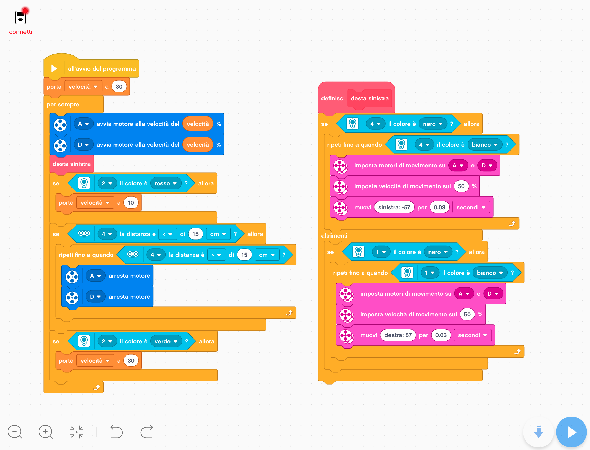

# lego-robotics-scratch
# 🚗 Lego EV3 Autonomous Driving

> 📅 **Timeline:** Progetto sviluppato nel 2023 (3° anno ITIS) - Il mio punto di partenza nella logica di programmazione.

## 📝 Descrizione del Progetto
Questo repository contiene il codice e la documentazione di un veicolo a guida autonoma sviluppato utilizzando il kit **Lego Mindstorms EV3** e programmato in **Scratch**. Il robot è in grado di navigare in autonomia su un tracciato, rispettando la segnaletica orizzontale e verticale e reagendo agli ostacoli imprevisti.

*Nota sul lavoro di squadra:* Questo è stato un progetto di gruppo. Io mi sono occupato principalmente dello **sviluppo del software, della logica degli algoritmi e dell'integrazione dei sensori**, mentre i miei colleghi si sono concentrati sull'assemblaggio hardware e sui test fisici su pista.

## 🧠 Logica del Software e Sensori
Il "cervello" del veicolo gestisce quattro sistemi principali in parallelo, affrontando e risolvendo anche un conflitto fisico di assegnazione delle porte sul mattoncino EV3.

*   **Avvio e Trazione Costante (Main Loop):** Un ciclo infinito gestisce la variabile globale `velocità`, garantendo trazione fluida ai motori A e D senza interruzioni.
*   **Mantenimento della Corsia (Lane Keeping):** Tramite due sensori ottici (porte 1 e 4), il robot legge i confini della pista. Se rileva il colore "nero" ai bordi, il software innesca un micro-ciclo di sterzata rapida (impulsi da 0.03s a 57 gradi) per rimettere il veicolo in carreggiata.
*   **Lettura Semafori (Sensore di Colore):** Un sensore frontale analizza l'ambiente. Quando legge il rosso, abbassa dinamicamente la variabile velocità per rallentare; quando legge il verde, ripristina la velocità di crociera.
*   **Frenata di Emergenza Anti-collisione:** Un sensore a ultrasuoni fa da radar frontale. Se rileva un ostacolo a meno di 15 cm, un'istruzione condizionale forza l'arresto immediato dei motori finché l'ostacolo non viene rimosso, riprendendo poi la marcia automaticamente.

## 🎥 Dimostrazione Pratica e Video
Il veicolo è stato testato con successo in laboratorio e mostrato al pubblico durante gli eventi di orientamento scolastico.

👉 **[Guarda i video dei test e la presentazione tecnica completa su Google Slides](https://docs.google.com/presentation/d/1AMrhTXMFQY71KDavvhzxd3m4h4yFLK7ttR6HK7B1x98/edit?usp=sharing)**
